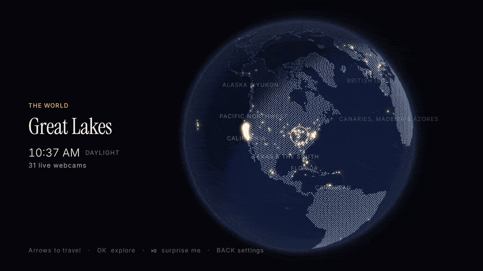

# lukarne

[](LICENSE)
[](https://github.com/storagebits/lukarne/releases/latest)

**A window onto the world for Android TV / Google TV.** Spin a night-and-day globe with the remote, dive into a
region, watch a wall of live webcams fill up, zap between cams in fullscreen, or press ⏯ and land somewhere in
daylight. About 830 cameras in 41 regions: 680 live video streams (California and Delaware road cameras, YouTube's
24/7 webcams) and Finnish weather cameras, in a catalogue rebuilt every day. No account, no ads, no tracking.

<p align="center">
  
</p>


## What it does

| | |
|---|---|
| **Globe** | A night-and-day Earth (the real terminator, at this minute) drawn with OpenGL at 60 fps; every glowing dot is a place with webcams. The arrows jump from region to region, OK dives in. |
| **Places** | Inside a region the arrows go from place to place (and on into the next region); the caption gives the local time, daylight or night, and how many cams are live. |
| **Walls** | A 3 × 3 mosaic of the cams around a place. The focused tile is live within ~2 s, up to 8 video streams play at once on a SHIELD, the others show recent frames. |
| **Fullscreen** | LEFT/RIGHT zap instantly between the cams of the wall; the caption shows the place, the country, the local time, the weather and the source. |
| **Surprise me** | ⏯ anywhere lands on a random live cam where it is daytime. **Demo mode** keeps going on its own, a new region every 20 s to 5 min. |
| **Corner player** | A cam left from fullscreen keeps playing, with its sound, in a corner while you browse (optional). |
| **Catalogue** | Caltrans and DelDOT live streams, Fintraffic weather cameras (stills) and curated YouTube live cams, rebuilt every day by GitHub Actions and downloaded at launch: no reinstall to get new cams. |
| **Languages** | English, French, Spanish; °C or °F. |
| **Updates** | A sideloaded copy checks GitHub for a newer release every 6 h and says how to get it; nothing is downloaded behind your back. |

Built and tested on an NVIDIA SHIELD (Android 11); runs on Android TV / Google TV 9 and later. Decisions,
measurements and the alternatives that were dropped are in [DECISIONS.md](DECISIONS.md).

**Built with Claude Code**: an AI wrote most of the code; I steered it and tested every release on a SHIELD.

## Install

1. On the TV, install **Downloader** (by AFTVnews) from the Play Store.
2. Allow it to install apps: *Settings → Device Preferences → Security & restrictions → Unknown sources →
   Downloader* (on Google TV: *Settings → Apps → Security & restrictions → Unknown sources*).
3. In Downloader, type this address and install:

   ```
   github.com/storagebits/lukarne/releases/latest/download/lukarne.apk
   ```

The same address always serves the newest release, signed with the same key, so it installs over the old one and
keeps your settings. When a new version is out, lukarne says so on the globe and in Settings.

## Using it

| Where | Arrows | OK | BACK | ⏯ Play/Pause | ≡ Menu |
|---|---|---|---|---|---|
| Globe, whole world | jump to the next region that way | zoom into the region | close the corner player, else the menu (demo, settings, quit) | surprise me | settings |
| Globe, zoomed in | jump to the next place (continues into the next region) | open the place's wall | back to the world | surprise me | settings |
| Mosaic (3×3) | move between tiles; DOWN past the last row turns the page | fullscreen | back to the globe | surprise me | settings |
| Fullscreen | LEFT/RIGHT: previous/next cam of the wall; UP/DOWN: show the caption | caption | back to the wall (the cam keeps playing in a corner if the corner player is on) | surprise me | settings |
| Demo | RIGHT: next cam now; other arrows: caption | stay on this cam (fullscreen) | stop, back on the globe at that place | next cam | — |

Settings: language (English by default, French, Spanish), °C/°F, still images, corner player (a cam left from
fullscreen keeps playing, with its sound, in the bottom-right corner while you browse), the demo's time per cam
(20 s to 5 min), and the source credits.

**Demo mode** (BACK on the whole globe → Demo mode): random live cams in daylight, never the same region twice in
a row, each one announced by a title card while it starts; any key but RIGHT ends it.

## Sources and credits

- [Caltrans CWWP2](https://cwwp2.dot.ca.gov/) — California DOT live cameras.
- [DelDOT](https://deldot.gov/) — Delaware DOT live cameras (the public feed behind deldot.gov's camera map).
- [Fintraffic Digitraffic](https://www.digitraffic.fi/) weather cameras — CC BY 4.0.
- YouTube live streams, played in YouTube's own embedded player under YouTube's terms.
- Weather: [Open-Meteo](https://open-meteo.com/) — CC BY 4.0. Maps: [Natural Earth](https://www.naturalearthdata.com/) — public domain.
- Fonts: Inter and Instrument Serif — SIL Open Font License (`third_party/fonts/`).

## For developers

Everything below is for building lukarne from source. **To watch webcams on your TV, you can stop here**: [Install](#install) and [Using it](#using-it) are all you need.

## Requirements

- JDK 17+ (tested with Temurin 21)
- Android SDK with `platforms;android-37.2` and `build-tools;36.0.0`
  ```sh
  sdkmanager "platforms;android-37.2" "build-tools;36.0.0" "platform-tools"
  ```
- Nothing else for the app: the Gradle wrapper downloads Gradle 9.7.1.
- For the catalogue pipeline: Python 3.11+ (it creates its own venv in `tools/catalog/.venv`).

## API keys (they stay out of git)

Put them in `local.properties` at the repo root (gitignored), one per line, no trailing comments:

```properties
sdk.dir=/path/to/Android/sdk
youtube.apiKey=...
release.storeFile=/path/to/upload.jks  # optional: the release signing key (see "Build and deploy")
release.storePassword=...
release.keyPassword=...
```

or export `YOUTUBE_API_KEY` / `LUKARNE_KEYSTORE`, `LUKARNE_KEYSTORE_PASSWORD`,
`LUKARNE_KEY_PASSWORD` (`LUKARNE_KEY_ALIAS`, default `lukarne`). The app itself embeds no key.

- **YouTube Data API v3** — <https://console.cloud.google.com/>: create a project, *APIs & Services → Library →
  YouTube Data API v3 → Enable*, then *Credentials → Create credentials → API key*, and restrict the key to that
  API. Used only by the pipeline: one `search.list` (100 units) per curated place, cached a week, plus
  `videos.list` (1 unit per 50 ids). The app never calls the Data API. Searches are also capped by a separate
  "Search Queries per day" quota; a run that hits it stops searching and the next run continues from the cache.

Without keys the pipeline keeps the cams of those sources from the previous catalogue; it never invents data.

## Build and deploy to the Shield

On the Shield: *Settings → Device Preferences → About → Build* (7 taps), then *Developer options → Network debugging*.

```sh
export LUKARNE_DEVICE=<shield-ip>:5555   # the Shield's address: Settings → Device Preferences → About → Status
tools/deploy.sh            # build the release APK, install it, launch it — one command
tools/deploy.sh debug      # same with the debug build
```

The release build is R8-minified. Use it for anything you look at: debug Compose is ~10× slower per frame on the
Shield. It is signed with the release key when `release.storeFile` is set, else with the debug key (fine for
sideloading, but an APK signed with another key can't update it). Create the release key once, and keep it and its
passwords somewhere safe outside the repo — every future update must be signed with it:

```sh
keytool -genkeypair -v -keystore ~/keys/lukarne-upload.jks -alias lukarne -keyalg RSA -keysize 4096 -validity 10000
```

The number of live HLS players is sized for the device at launch (hardware H.264 decoder instances and RAM; 8 on
the Shield, logged as `decoder budget` under `Lukarne.Hls`).

**macOS and "No route to host".** macOS 15+ blocks adb from the local network unless the app that started it has
the *Local Network* permission. `tools/device.sh` (used by every script) tries a direct `adb connect`; if that
fails it starts `tools/adb-relay.sh`, which relays `127.0.0.1:15555` to the Shield through Apple's `/usr/bin/nc`,
and connects to that. The clean fix is to allow your terminal in *System Settings → Privacy & Security → Local
Network*.

## Regenerate the catalogue

```sh
tools/catalog/build.sh                      # all sources whose keys are present → app/src/main/assets/catalog.json
tools/catalog/build.sh --only youtube       # one source; the others are kept from the previous catalogue
tools/catalog/build.sh --only none          # no network: re-cluster after editing regions.py or youtube_places.json
adb pull /sdcard/Android/data/app.lukarne/files/dead.json
tools/catalog/build.sh --dead dead.json     # also drop the cams the Shield found dead
tools/deploy.sh
```

- **Sources.** YouTube (curated spots and 24/7 channels) and the open road-camera feeds. Windy's webcams (stills
  only, ~10,000 of them) were dropped before publishing: its API terms forbid redistributing what it returns and
  continuous automated scanning (DECISIONS.md, V1.8).
- **Daily refresh, no reinstall.** `.github/workflows/catalog.yml` rebuilds YouTube and the road cams every day at
  04:17 UTC (`--no-search`: YouTube from channels + `videos.list`, ~700 units, no search quota; the road cams with
  their streams probed, so dead ones drop out) and force-pushes the result to the public repo [storagebits/lukarne-catalog](https://github.com/storagebits/lukarne-catalog). At launch, behind
  the logo, the app downloads it (at most once an hour) and uses whichever of it and the APK's own copy is newer;
  offline it keeps the last one it had. Its secrets: `YOUTUBE_API_KEY` and `CATALOG_DEPLOY_KEY` (a write deploy
  key of lukarne-catalog). Run it by hand with `gh workflow run catalog`.
  The public repo's `README.md` and `LICENSE` are copied from `tools/catalog/publish/`: edit them there, since every
  run replaces the whole public repo.
- **Commit and push every local build.** The daily run starts from the `catalog.json` *on GitHub* and the device keeps
  the newest one it sees: a catalogue built and installed from your Mac but not pushed works that evening, then the
  next morning's (newer, built without your change) replaces it on the Shield.
- Add a YouTube spot by appending to `tools/catalog/youtube_places.json` (place, coordinates, a search query, and
  the words a result's title must contain), then `build.sh --only youtube`.
- Or add a 24/7 webcam channel to `tools/catalog/youtube_channels.json`: its id and one rule per place (words of
  the live video's title → place, coordinates). Channels cost no search quota, so they refresh on every build.
- Regions (the first focus level, EN/FR names) are in `tools/catalog/regions.py`.
- The globe geometry (`land_dots.bin`, `coast.bin`) comes from Natural Earth via
  `tools/catalog/.venv/bin/python -I tools/catalog/geo.py`; the banner and icons from `swift tools/render_brand.swift`.

## Publishing

Development happens in a private repo; [storagebits/lukarne](https://github.com/storagebits/lukarne) is its public
mirror, one commit per publish (`tools/publish.sh "message"`, from a clean tree; `--dry-run` shows what would
change). The mirror leaves out `shots/` and the internal notes (`BRIEF.md`, `REPORT.md`, `REPRO.md`). The daily
catalogue run only runs in the private repo, where its secrets are.

A release: bump `versionCode` and `versionName` in `app/build.gradle.kts`, commit, then
`tools/release.sh [--draft] [--dry-run] docs/release-notes/X.Y.Z.md` (builds, checks the APK is signed with the
release key, mirrors the code, creates the GitHub release with `lukarne-X.Y.Z.apk` and `lukarne.apk`, the APK's
SHA-256 and the certificate's appended to the notes; `--draft` keeps it invisible until it is published on GitHub,
`--dry-run` stops before pushing anything). Both scripts run on macOS and Linux. A sideloaded install asks GitHub for the latest release
at most every 6 h and shows "Version X available" on the globe and in Settings, with the stable link
`github.com/storagebits/lukarne/releases/latest/download/lukarne.apk` to type in the Downloader app. An install
from Google Play never checks: the store updates it.

## Captures

The GIF and the pictures above come from the release build, on the SHIELD and on the Android TV emulator, and are
made again with `tools/make_screens.sh` (`shots`, `record`, `frames`, `gif`, `update`, `publish`; see its header).
Live cams change by the minute, so a rerun gives other pictures. Only road cameras appear in them, and every frame
is checked before it is committed: no readable plate or face, no notification, no address.

## Measuring on the device

| Tool | What it does |
|---|---|
| `tools/shot.sh <name> [am-start extras]` | install, launch, capture `shots/<name>.png`, print the app's log lines |
| `tools/jank.sh "<steps>" [extras]` | press keys with the in-app autopilot, print frame stats (UI thread) |
| `tools/framestats.py` | break slow frames down by phase (`dumpsys gfxinfo app.lukarne framestats \| tools/framestats.py`) |
| `adb logcat -s Lukarne.Globe` | GL thread fps, gaps and draw time every 5 s (the globe is invisible to gfxinfo) |
| `tools/soak.sh [minutes] [every_s]` | autopilot browsing loop with memory sampling → `shots/soak/soak.csv` |

Launch extras (`adb shell am start -n app.lukarne/.MainActivity …`):

| Extra | Effect |
|---|---|
| `--es place california/sacramento` | start on a place's mosaic (ids are in `catalog.json`) |
| `--es cam caltrans:D5/1atHearstCastle` | start on a cam in fullscreen, over its wall (ids are in `catalog.json`) |
| `--ei maxLive 10` | HLS decoder budget (default 8) |
| `--es locale fr` | force the UI language for this run |
| `--ez demo true` | start straight into the demo |
| `--ei freshAfterS 5` | back from the TV home after this long → start over behind the logo (default 30 min) |
| `--es autopilot right,down,ok,wait,back --ei autopilotDelay 1500 --ei autopilotRepeat 10` | press keys from inside the app (`up down left right ok back menu play wait random`); commas, not spaces |

## Project layout

```
app/src/main/java/app/lukarne/
  MainActivity.kt      entry point (Leanback launcher), splash while the catalogue and globe load
  LukarneApp.kt        Application + AppGraph (manual wiring): OkHttp, Coil, players, settings, weather
  Autopilot.kt         in-app key presses for measurements and soak tests
  model/Webcam.kt      the source-agnostic webcam record (HLS | YouTube | image)
  data/                catalogue loader (regions, places, zones), settings, Open-Meteo weather
  player/              HlsPool (recycled ExoPlayers under a decoder budget), YouTubeStage (one IFrame WebView,
                       handed over by ownership), StreamHealth (dead list)
  globe/               sphere maths, focus model and D-pad jumps, Compose overlay (ring, labels)
  globe/gl/            GLES 2 globe on a SurfaceView: shaders, VBOs, render thread
  ui/                  screens (globe, mosaic, fullscreen), CamView, stills, postcard, info band, settings, theme
tools/
  catalog/             pipeline: build.py, sources/ (youtube, caltrans, deldot, digitraffic), regions, geo.py
  deploy.sh device.sh adb-relay.sh shot.sh jank.sh framestats.py soak.sh quit-check.sh
  publish.sh release.sh make_screens.sh screens.py render_brand.swift
```
